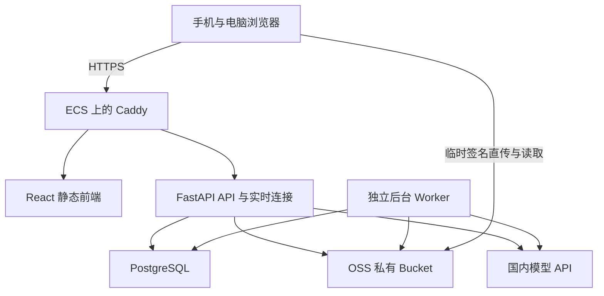

# AI 笔记 Web 系统架构与开发任务

版本：v1.0 架构草案。日期：2026 年 10 月 14 日。

面向本人和少数朋友，建设跨手机和电脑的手写图片笔记、富文本、AI 学习、复习与社交 Web。采用 React 前端、FastAPI 模块化单体后端、PostgreSQL 数据库、OSS 私有文件存储和独立后台 Worker。分阶段交付功能，每个阶段均支持手机和电脑。

此前用户已确认的产品决定保持有效。本文新增的技术规则作为开发默认建议，部署参数与资源上限集中配置；尚未实际创建云资源、编写应用代码或验证服务器性能。

# 1 产品边界与交付范围

| 项目 | 已确认的产品要求 |
|---|---|
| 使用对象 | 本人和少数朋友；完全免费，现阶段不做会员、付费积分、支付 |
| 用户入口 | 管理员管理邀请码；普通用户通过邀请码注册 |
| 设备 | 手机、电脑均支持完整功能，交互方式适配屏幕和触控 |
| 内容 | 图片笔记与富文本并存，互相引用和转换；文件夹、笔记本、标签混合组织 |
| 上传 | 智能扫描、优化、预览整理；保留原图 |
| PDF 输入 | 一份 PDF 导入为一篇多页图片笔记，保留原件；后台按页渲染、进度、失败续转，复用现有阅读器 |
| 编辑 | 所见即所得与 Markdown 混合；数学公式和代码块 |
| AI | 独立聊天、笔记专属会话、回答保存为笔记；国内模型，管理员统一提供共享 API Key |
| 共享模型 | 所有登录成员共用后端凭据，无需个人 Key；真实值只在当前电脑的私密配置中，网页不返回 |
| 搜索 | 关键词、OCR、语义搜索，定位原始笔记及引用来源；允许分阶段实现 |
| 复习 | 手动与智能排期；笔记、卡片、测验各自独立计划，在统一复习中心管理 |
| 卡片 | 手动创建与 AI 草稿；审核、批量编辑、确认后加入复习 |
| 提醒 | 每日一次汇总，用户自定义时间 |
| 分享 | 好友只读；社区发布独立公开副本，私人原笔记保持私人 |
| 社交 | 好友与关注双系统，私聊、社区发帖；学科、帖子类型、自由标签 |
| 首页与隐私 | 综合学习工作台；个人详细资料仅好友可见，学习数据默认私人 |

M1 交付个人笔记与 AI 的可用版本；M2 交付搜索、卡片、测验与复习闭环；M3 交付好友、社区和工作台。后续阶段承接最终范围，不表示删除功能。

# 2 部署与通信架构

| 组件 | 初期部署与职责 |
|---|---|
| Caddy | HTTPS、静态资源、API 与 WebSocket 反向代理；AI 流式路径关闭不必要缓冲 |
| React | Vite 构建静态文件；同源调用后端，不在生产启动 Vite 开发服务器 |
| FastAPI | 用户认证、权限、业务 API、AI 交互、WebSocket；初期一个服务进程 |
| Worker | 与后端共享代码但独立进程；处理 OCR、索引、导出、通知、清理与批量任务 |
| PostgreSQL | 独立容器、持久化卷；仅内部网络可访问；不对公网开放数据库端口 |
| OSS | 文件、原图、阅读图、缩略图；私有 Bucket，按权限临时签名访问 |
| 模型 API | 外部推理；ECS 不运行大模型。本地重量级 OCR 不纳入初期部署 |

前端、API 与实时连接采用同源部署：`notes.你的域名`、`/api/v1`、`/api/v1/realtime/ws`。为图片预留 `assets.你的域名` 并绑定 OSS，配置 HTTPS 和限定前端来源的 CORS。具体域名和地域在部署任务中填写。

阿里云官方当前说明：通过 OSS 提供的访问域名访问图片等文件可能触发强制下载；在线预览应使用自定义域名。因此不能默认把 OSS Endpoint 当作最终阅读地址。[官方说明](https://www.alibabacloud.com/help/zh/oss/user-guide/regions-and-endpoints)

开发环境通过前端代理保持相同的 URL 结构。生产数据库与开发数据库、Bucket 前缀、凭证严格分开。软件版本在初始化时选择兼容的稳定版本并固定锁文件，不直接跟随 latest。

暂不引入 Redis、微服务或 Kubernetes。单进程连接管理适合当前小规模；FastAPI 官方示例也指出内存连接管理只适用于单进程。以后扩展多个 API 进程时，再加入跨进程事件分发，不能只增加进程数量。[WebSocket 文档](https://fastapi.tiangolo.com/advanced/websockets/)

# 3 模块与代码边界

| 模块 | 拥有的业务 | 主要联动 |
|---|---|---|
| auth | 用户、会话、邀请码、角色、账户停用 | 向其他模块提供当前身份 |
| files | 上传会话、文件元数据、变体、签名与删除 | 笔记、聊天、社区、导出 |
| notes | 文件夹、笔记本、页面、富文本、引用、版本 | 搜索、AI、分享、复习 |
| ai | 服务商、共享模型配置、模型能力、会话、生成运行 | 经权限检查读取笔记；生成草稿 |
| search | OCR 文档、分块、关键词与向量索引 | 不拥有原笔记，随源版本更新 |
| learning | 卡片、测验、复习计划、学习事件与统计 | 读取笔记来源；创建汇总提醒 |
| social | 好友、关注、私聊、只读授权 | 文件签名、笔记权限 |
| community | 帖子、公开副本、评论、收藏、审核 | 不直接公开 notes 的私有记录 |
| notifications | 通知偏好、持久通知、推送事件 | 汇总复习、好友、社区 |
| jobs 与 admin | 后台任务、系统配置、审计、人工重试 | 管理操作通过同一权限系统 |

API 层校验请求，Service 层处理业务和权限，Repository 层访问数据库，Adapter 层访问 OSS 和模型服务。跨模块调用 Service，不直接改写别的模块的表。API 与 Worker 共用 Service，避免出现两套规则。

建议仓库：`frontend/`、`backend/app/modules/`、`backend/app/shared/`、`backend/alembic/`、`infra/`、`docs/`。后台入口为 `backend/app/worker.py`；每个业务模块按需拆为 router、schemas、models、service、repository，避免创建没有用途的空文件。

# 4 身份与访问权限

采用服务端会话：浏览器持有随机不透明会话 Cookie，数据库保存会话令牌哈希、用户、过期时间和撤销状态。Cookie 使用 HttpOnly、Secure、SameSite=Lax；修改操作校验 CSRF Token 与 Origin，WebSocket 握手检查 Origin。密码采用 Argon2id 哈希；API Key、密码和会话原文不写日志。

注册在同一事务中检查、锁定并消费邀请码，防止最后一个名额被并发重复使用。邀请码只保存哈希及额度、期限、停用状态；生成时展示一次明文。登录失败和注册设限流，管理员从命令行初始化，不提供公开的管理员注册入口。

| 资源 | 所有者 | 获授权好友 | 其他用户 | 管理员 |
|---|---|---|---|---|
| 私人笔记 | 读写、分享、删除 | 按授权只读 | 不可访问 | 不默认读取内容 |
| 私人 AI 会话 | 本人访问 | 不可访问 | 不可访问 | 不默认读取内容 |
| 共享模型 Key | 不通过网页访问 | 不通过网页访问 | 不通过网页访问 | 只在本机后端私密配置维护，网页无明文或掩码 |
| 复习与统计 | 本人访问 | 默认不可访问 | 不可访问 | 仅必要运维信息 |
| 已发布社区副本 | 发布者维护副本 | 按社区可见范围 | 按社区可见范围 | 可审核与下架 |
| 私聊消息与附件 | 参与双方 | 非参与者不可访问 | 不可访问 | 不提供默认浏览入口 |

管理员负责邀请码、账户、系统参数和内容审核；角色不意味着可以静默读取所有私人内容。所有资源接口、搜索、AI 取材和文件签名使用同一权限判断。前端隐藏按钮不作为权限控制。

只读分享授予“查看”能力；允许 AI 处理、导出或复制应是独立能力。默认不因好友只读权限就允许把原笔记交给第三方模型。撤销授权立即阻止新的读取和签名；已发出的短期签名在到期前可能有效，已下载或已发送给模型的内容无法收回。

无邮件服务时，初期账户恢复采用管理员核实后生成一次性重置凭证，完成后撤销旧会话；以后再扩展邮件找回。

# 5 数据结构

采用 UUID 标识；外键保护关系，时间使用 UTC timestamptz，用户设置保存 IANA 时区，国内默认 Asia/Shanghai。顺序、可见性、删除状态、当前版本明确建模。以下为逻辑设计，建表迁移按开发阶段创建。

| 领域 | 表与关键字段 |
|---|---|
| 用户 | users：role、status、password_hash；sessions：token_hash、expires_at；invite_codes：code_hash、max_uses、used_count |
| 设置 | user_settings：timezone、review_time、notification_preferences；system_settings：上传限制、功能开关 |
| 组织 | folders：owner_id、parent_id；notebooks：owner_id、folder_id；notes：owner_id、notebook_id、kind、revision、deleted_at |
| 页面 | note_pages：note_id、position、file_id、transform、revision；note_bodies：note_id、editor_schema_version、body_json、plain_text |
| 标签与引用 | tags、note_tags；note_links：source_note_id、target_note_id、page_id、region、source_revision |
| 文件 | files：owner_id、object_key、status、bytes、sha256、mime；file_variants：file_id、kind、object_key；upload_sessions：expires_at、expected_size、status |
| 版本与附件 | note_versions：note_id、revision、snapshot；file_links：file_id、所属资源、用途，删除前检查引用 |
| AI | ai_credentials：owner_id、provider、ciphertext、key_version；ai_models：capabilities；ai_conversations：owner_id、scope、note_id；ai_messages：conversation_id、role、content、status |
| AI 运行 | ai_runs：conversation_id、credential_id、model、status、request_key、usage、error；ai_contexts：run_id、source_id、revision、page、region |
| 搜索 | extracted_documents：page_id、source_revision、text、confidence；search_chunks：owner_id、source_id、revision、text；embedding_indexes：chunk_id、provider、model、dimensions、vector |
| 卡片 | decks、cards：owner_id、kind、status、front、back、source_reference；卡片状态 draft、confirmed、archived |
| 测验 | quizzes、quiz_questions：题干、参考答案、来源版本；quiz_attempts、quiz_answers：用户答案、判分结果、复核状态 |
| 复习 | review_items：owner_id、kind、note_id/card_id/quiz_id；review_plans：item_id、strategy、next_due_at、scheduler_state、algorithm_version、revision；review_logs：plan_id、rating、mode、scheduled_for、reviewed_at |
| 学习统计 | learning_events：用户、资源、event_id、开始结束、活动类别；指标从事件与复习记录汇总 |
| 社交 | friendships：规范排序的双方、status；follows：follower_id、followee_id；note_grants：note_id、grantee_id、capabilities、revoked_at |
| 私聊 | chat_threads、chat_participants；chat_messages：sender_id、client_message_id、thread_seq、body、created_at；chat_read_cursors |
| 社区 | posts：owner_id、category、type、status；published_note_snapshots：post_id、snapshot_version、source_revision；snapshot_assets：独立副本文件；comments、reactions、bookmarks、reports |
| 通知与任务 | notifications：user_id、type、dedupe_key、read_at；outbox_events；jobs：type、status、payload、attempts、run_after、lease_until、worker_token；audit_logs |

review_items 使用三种显式外键，并用 CHECK 约束保证类型与“恰好一个非空来源”一致。每个用户、复习对象保留一个有效计划，其他计划暂停或归档。笔记、卡片和测验之间的来源关联只用于追溯，不共享复习状态。

关系约束与索引：笔记索引 owner_id＋notebook_id；文件夹禁止环和跨用户父节点；卡片和计划按 owner_id＋next_due_at；消息唯一约束 sender_id＋client_message_id，线程内 thread_seq 唯一；每日复习提醒唯一约束用户＋通知类型＋当地日期；后台 jobs 按状态＋run_after 查找。属于同一用户的跨表关系在 Service 和数据库约束可实现的部分共同校验。

富文本以 Tiptap JSON 为唯一编辑事实来源，plain_text 和 Markdown 是派生表示。切换 Markdown 时对不支持的节点提示转换损失；保留原版本，不能宣称所有富文本都可以无损双向转换。图片转换为文字创建新内容并保留来源，原图不被覆盖。

# 6 关键业务流程

## 6.1 上传与图片阅读

1. 前端扫描、裁剪和预览；保存原文件与裁剪参数。创建笔记页面不依赖 OCR 成功。
2. 后端验证用户、资源和容量；创建 uploading 文件与上传会话，按预期大小预留容量并签发短期凭证。
3. 浏览器直传 OSS 的隔离上传前缀。服务端生成对象键，签名约束具体对象和操作，不能让用户任选路径。选择带大小限制的上传策略。
4. 前端调用 complete，后端查询真实对象、确认大小类型，再由 Worker 检查可解码性、像素上限和摘要。原图只有通过检查才进入 ready；异常对象删除，释放容量。
5. Worker 生成阅读图、缩略图，创建 OCR 任务。变体失败允许重试，原图正常时仍可阅读；前端明确显示处理状态。
6. 阅读请求先检查所属笔记权限，再签发短期下载地址；地址到期重新获取。数据库保存 object_key，不保存长期有效签名 URL。

默认建议：单文件 20 MiB、每批 50 张、签名约 5 分钟。它们是可调整的初始参数，不是此前已确认的产品配额；同时控制解码后像素数、任务并发与用户在途上传总量。

上传凭证到期、页面关闭或 complete 未执行时，定期清理过期上传并回收预留额度。删除业务记录与删除 OSS 对象用状态机和任务衔接，不能假设数据库事务可以回滚 OSS 操作。文件有有效引用、历史版本或保留中的副本时不能物理删除。

## 6.2 保存与跨设备冲突

每次保存携带当前 revision，服务端执行带版本条件的更新；成功后返回新 revision。版本已变化返回 409，前端保留本地草稿，让用户选择查看差异、复制为新笔记或重新编辑，不静默覆盖。

页面重排、裁剪、富文本、整本移动同样使用相关资源版本；顺序更新在事务内完成。自动保存状态显示未保存、保存中、已保存和冲突。初期离线只保护本机草稿，不承诺完整离线同步；退出账户时可清理本地私人缓存。

## 6.3 AI 会话与流式响应

用户选择受控模型，所有登录成员共用管理员在后端配置的凭据。后端按 capability 判断文字、图片、工具、embedding 支持；不会把支持文本的模型当作视觉模型。

创建运行时冻结来源版本，检查每份笔记、页面或选区的权限；向用户展示本次资料范围。输入作为参考内容，不能用笔记中的指令越过系统权限。模型没有数据库直连能力，任何工具访问都经过后端授权。

提交 POST 创建 ai_run 和用户消息，携带 request_key 防止重复点击重复计费；使用 fetch 读取 SSE 格式事件，不依赖只能 GET 的原生 EventSource 发送聊天请求。事件包含 meta、delta、citation、usage、done、error。先持久化运行记录，再调用模型；结束后保存完整回答，断线或错误保留部分内容和明确状态。

2026-10-16 文字阶段复用现有 Worker 执行一次模型请求，API 只流式读取持久化结果；运行租约失效后恢复为 interrupted，不自动重新收费调用。采用独立 ai_runs 领取流程，避免通用 jobs 自动重试产生重复费用；当前单 Worker 与 PDF/图片任务串行执行。重连查询已有运行结果，需要继续生成时由用户发起新运行。取消在服务商支持范围内中止上游，已经产生的用量仍记录。

模型适配器提供 stream_chat、vision、embed 等独立接口，记录 provider、model、dimensions 和 tokenizer/分块版本。按 2026-10-16 用户确认，当前共享 DeepSeek Key 仅保存在这台电脑的后端 `DEEPSEEK_API_KEY` 私密配置中，不存业务数据库、不放进前端、日志或 Git。网页仅显示共享服务状态和受控能力；管理员可测试连接，所有成员无需提供个人 Key。未来迁移到其他服务端须另行授权配置凭据，不能随代码或镜像复制真实值。

初期服务商地址采用受控名单。自定义兼容地址以后增加 SSRF 防护：HTTPS、禁止本机与内网地址、检查 DNS 与重定向，防止模型地址访问 ECS 内网。后端检查共享凭据是否配置，未配置时明确不可用，不接受浏览器提交的 Key 覆盖配置。

2026-10-16 PDF 对话阶段已实现选页与整本模式。原 PDF 页码独立于笔记页序保存；创建运行冻结原页身份、阅读图对象与版本，浏览器只收到安全的页码引用。整本按最多 8 页 / 12 MiB 分批读取，长阅读记录四组逐层汇总，最终生成回答；每次收费调用前先写 ai_steps，不自动重发已启动的阶段。范围预览、已读页数与已知用量对用户可见，回答引用可打开经授权的原页。设计和边界见 [PDF选页与整本AI对话](PDF选页与整本AI对话.md)。

## 6.4 OCR 与搜索

图片变更时生成带 source_revision 的 OCR 任务。任务写回前再次核对版本；旧版本结果不覆盖当前页面。提取文本允许用户纠错，公式可保存 LaTeX 和区域位置，低置信度内容显示待核对。

第一步实现标题、标签、富文本和 OCR 文本的中文包含匹配，满足小数据量使用；之后增加中文分词与索引。不能仅启用 PostgreSQL 默认英文全文配置就认为中文 OCR 搜索已经解决。[PostgreSQL 解析器文档](https://www.postgresql.org/docs/current/textsearch-parsers.html)

语义搜索是可选增强：用户配置支持 embedding 的模型才建立索引，未配置时保留关键词搜索。不同模型维度的向量不混用；模型改变时创建新索引版本，后台重建后切换。所有检索在用户可访问范围内计算候选，送给 AI 之前再次验权；来源删除、撤销或版本失效时禁止返回陈旧内容。

搜索结果与 AI 引用包含 note_id、page_id、region、source_revision。客户端跳转原页和选区，源已变更时显示“引用来自历史版本”，不假装定位到当前相同文字。

## 6.5 复习与学习统计

卡片 AI 生成进入 draft，用户审核确认才建立计划。笔记、卡片、测验各自创建 review_item 和 review_plan，在同一个待办视图展示。

采用统一调度接口，支持 manual 和 fsrs。建议卡片先接入 FSRS，评价采用忘记、困难、良好、轻松四档，与官方四种 Rating 对齐；笔记和测验初期也能手动或智能排期，但智能排期依赖用户主动回忆后的评价，不直接把测验百分数等同于记忆评级。[Py FSRS 官方说明](https://github.com/open-spaced-repetition/py-fsrs)

整份笔记和整套测验较宽，FSRS 在这些对象上的效果需从实际使用评估；算法数据独立保存，不宣称与原子卡片有相同预测准确度。手动修改 next_due_at 记录原因和旧时间；临时练习默认不改变计划。策略切换保留历史日志，计划更新使用版本检查。

每日 Worker 根据用户时区、时间设置和到期任务生成一次站内汇总。唯一键使用当地日期；更改提醒时间不会当天重复发送。宕机恢复时仅补发当天错过且仍有待办的提醒，不补发历史多日。初期承诺站内提醒；浏览器推送另列任务，用户关闭网页仍能收到消息需要推送权限和实际设备支持，不能只靠网页定时器。

统计分别显示阅读进度、复习完成、主动掌握评价、测验结果。有效学习时长按活动和闲置阈值计算，同一用户多设备重叠区间合并；心跳使用 event_id 去重。阅读过不等于掌握，不输出缺少依据的精准掌握概率。

## 6.6 私聊与社区副本

好友请求与关注分开。发送私聊检查双方关系和参与权限，先写 chat_messages，再发实时事件；客户端收到数据库消息 ID 才显示发送成功。离线消息保存在数据库，重连按线程游标补拉；在线状态仅是短时状态，不代表消息已读。

好友授权撤销后立即停止新阅读。聊天附件通过会话参与者权限签名，不以拿到 file_id 作为访问资格。

社区发布生成内容快照和独立文件副本，完整准备成功才发布；复制失败时保持 preparing，不能半成品公开。副本不得保留能绕过权限访问私人原图的链接。原笔记后续修改、删除或撤销好友分享不影响已发布副本；更新社区内容必须显式再发布。用户撤回社区副本后停止展示和新签名，已下载内容无法收回。

# 7 后台任务与可靠性

OCR、批量处理、向量索引、导出与通知进入 PostgreSQL 持久 jobs 表，由独立 Worker 拉取。业务写入与入队同事务提交；长任务不能只靠进程内 BackgroundTasks。

领取任务使用短事务与 FOR UPDATE SKIP LOCKED，写入 lease_until 和 worker_token 后提交，再执行耗时工作。续租失败停止写回；完成时带 worker_token 条件，防止租约过期后的旧 Worker 覆盖新执行者。重启后回收过期租约；重试指数退避，有最大次数和管理员重试入口。[PostgreSQL 锁定说明](https://www.postgresql.org/docs/current/sql-select.html)

语义为至少一次执行：用 dedupe_key、源版本与唯一约束让业务幂等，不宣称恰好一次。外部 AI 调用若结果不确定，记录 unknown，避免自动重试带来重复费用。对明确未被服务商接受的请求或其他幂等任务按策略重试。

通知、消息投递通过 outbox：业务变更与事件同事务，投递可重复，客户端按事件 ID 去重。通知内容保存在 notifications，Worker 处理的事件由 API 从数据库捕获后广播；不能假设 Worker 的内存直接共享给 API。数据库通知可作为唤醒优化，持久表仍为补拉依据。

# 8 接口与客户端约定

| 资源 | 代表接口 |
|---|---|
| 账户 | POST /auth/register、/auth/login、/auth/logout；GET /auth/me；POST /auth/password/reset |
| 邀请码 | POST /admin/invites；PATCH /admin/invites/{id} |
| 笔记 | GET/POST /notes；GET/PATCH/DELETE /notes/{id}；POST /notes/{id}/restore |
| 页面 | POST /notes/{id}/pages；PATCH /notes/{id}/pages/order；PATCH /pages/{id} |
| 文件 | POST /files/uploads；POST /files/uploads/{id}/complete；GET /files/{id}/access |
| AI | POST /ai/credentials；POST /ai/credentials/{id}/test；POST /ai/conversations；POST /ai/conversations/{id}/runs；GET /ai/runs/{id}；POST /ai/runs/{id}/cancel |
| 搜索 | GET /search；POST /notes/{id}/reindex |
| 学习 | POST /cards/generate；POST /cards/{id}/confirm；POST /quizzes；POST /quizzes/{id}/attempts；GET /review/due；POST /review/plans/{id}/ratings |
| 社交社区 | POST /friend-requests；POST /notes/{id}/grants；POST /chat/threads/{id}/messages；POST /posts；POST /posts/{id}/publish |
| 系统 | GET /notifications；PATCH /settings；POST /exports；GET /jobs/{id}；GET /health/live；GET /health/ready |

分页采用稳定排序和 cursor，避免大量消息使用不稳定偏移。错误包含 code、message、request_id、必要 details；区分登录过期、权限拒绝、版本冲突、上传超限、凭证无效、模型限流。长任务返回 202 与 job_id；明确哪个接口产生流式响应。

TanStack Query 管理服务器数据，Zustand 只管理面板、选区和本机交互状态。后端 OpenAPI 生成 TypeScript 客户端类型，业务数据不复制成多套前端事实来源。

# 9 运维与数据保护

数据库每日备份至 ECS 外独立位置；建议初始保留最近 7 个日备份、4 个周备份。备份包含数据库和文件清单，OSS 原图配置版本与删除保护并评估费用；另做异地或独立账号副本，OSS 版本控制不等于完整备份。定期在隔离环境验证恢复数据库、原图与 Key 解密能力。

初期目标 RPO 不超过 24 小时、RTO 不超过 4 小时，属于设计目标，只有恢复演练通过后才作为实际能力。回收站建议保留 30 天，版本建议至少保留最近 20 次和关键快照，作为可配置值。物理删除检查所有文件引用、保留时间和导出任务。

日志含 request_id、用户 ID、业务资源 ID、耗时、状态；默认不记录笔记、聊天正文、Key、会话和签名 URL。监测磁盘、内存、数据库连接、上传失败、后台积压、模型错误与费用信息。免费指用户不付平台费用，云服务器、OSS、网络仍可能产生费用；共享模型调用费用归提供 Key 的 DeepSeek 账户。

部署前备份、运行迁移、健康检查、最小冒烟。数据库迁移先做向后兼容扩展，回滚应用不直接回滚有数据的迁移。ECS 内资源由实测决定，2 核 4 GiB 作为起步假设；Worker 图片任务先设并发 1，再依据内存与响应时间调整。

# 10 开发任务与验收

每项任务以可演示结果验收，前后端在同一任务内形成闭环。任务编号用于依赖和开发追踪。没有运行应用前不估算精确人日。

## 10.1 M0 工程与基础权限

| ID | 任务 | 依赖 | 验收 |
|---|---|---|---|
| T01 | 仓库、前后端工程、配置、锁文件、Docker 本地环境、CI | 无 | 新环境按说明启动；前端和 API 可访问；构建及核心检查通过 |
| T02 | 数据库基础迁移、事务、ID、时间、错误与 OpenAPI 类型 | T01 | 空库可迁移；前后端类型一致；错误有 request_id |
| T03 | 会话、邀请码注册、密码、限流、退出与恢复 | T02 | 最后一个邀请码名额并发注册只成功一次；退出后会话无效 |
| T04 | 统一资源权限、管理员边界、审计 | T03 | 用户 B 猜到用户 A 的 ID 仍不能读取、写入或签名；管理员边界符合设计 |
| T05 | jobs、租约、重试、outbox 与 Worker | T02 | 任务执行中杀进程后恢复；重复领取不会重复产生业务记录 |

M0 验收：系统可运行，有真实身份、资源隔离和可恢复后台任务。

## 10.2 M1 个人笔记与 AI

| ID | 任务 | 依赖 | 验收 |
|---|---|---|---|
| T06 | 文件夹、笔记本、标签、图片与文本笔记 CRUD | T04 | 手机电脑都可建立、移动、筛选笔记；禁止跨用户移动和文件夹环 |
| T07 | OSS 存储适配、私有 Bucket、图片域名、临时签名 | T04 | 真环境可上传和预览；无权限不给签名；过期地址无法新读取 |
| T08 | 批量上传、断线重试、预览排序、后台变体与容量清理 | T05、T06、T07 | 上传部分失败不丢成功页面；伪造大小和超大解码图被拒绝；过期预留回收 |
| T09 | 图片阅读器、缩放、拖拽、触控、页面选区 | T08 | 手机触控与电脑操作通过；页码、区域定位可还原 |
| T10 | Tiptap、公式代码块、Markdown 转换、自动保存与版本冲突 | T06 | 两设备同时编辑不覆盖；离线草稿可恢复；不支持的转换有提示 |
| T11 | 共享 Key 后端配置、国内模型适配、能力表与连接测试 | T04 | 所有成员无需个人 Key；真实值不出现在浏览器或日志；失效和不支持图片给明确结果 |
| T12 | 独立与笔记 AI 会话、流式、取消、历史与去重 | T09、T10、T11 | 真模型完成文本和图片对话；重复提交只有一个运行；断线可查结果 |
| T13 | AI 来源权限、选区引用、回答保存、上下文范围 | T12 | 回答可保存并跳回原页；未授权内容无法送入模型；超预算输入可控 |
| T14 | 回收站、导出、备份与首次恢复演练 | T05、T08、T10、T13 | 恢复已删除笔记；导出能重建正文与原图；备份在空环境恢复成功 |
| T15 | ECS 部署、Caddy、HTTPS、secret、迁移与监测 | T14 | 使用真实域名走通注册、上传、阅读、AI；容器重启数据仍在 |

M1 验收：真实用户在手机上传笔记，电脑打开并使用管理员统一提供的模型服务问 AI，把回答保存为笔记；另一个用户无法越权；数据能恢复。真模型与云端验收需要有效共享凭据和资源，模拟接口只用于开发，不算通过。

## 10.3 M2 搜索与学习闭环

| ID | 任务 | 依赖 | 验收 |
|---|---|---|---|
| T16 | OCR、用户纠错、区域坐标与源版本失效 | T05、T08、T11 | OCR 失败可重试；旧结果不覆盖新页；纠错后能定位原页 |
| T17 | 中文关键词搜索、分页、权限与结果定位 | T10、T16 | 中文手写关键词能找到已识别页；删除和越权资源不出现 |
| T18 | embedding 配置、pgvector、索引版本与语义检索 | T05、T11、T17 | 无 embedding 时关键词仍可用；模型换维度不混查；重建可回退 |
| T19 | 卡片集、四类卡片、AI 草稿、批量审核与来源 | T09、T10、T13 | 问答、填空、遮挡、公式可编辑；草稿不进入待复习 |
| T20 | 笔记、卡片、测验的独立计划与统一待办 | T19 | 复习一张卡片不改变源笔记进度；临时练习不改到期时间 |
| T21 | 测验生成、题目校验、作答保存、判分与复核 | T11、T13、T20 | 各题型有合法结构；断线不丢答案；AI 不确定判分可复核 |
| T22 | FSRS 适配、四档评价、手动排期与策略切换 | T20、T21 | 评级更新计划；并发评价不重复推进；策略切换保留历史 |
| T23 | 通知中心、偏好、每日汇总与用户时区 | T05、T22 | 重启和重复调度仍当天一次；改时间不重发；关闭通知有效 |
| T24 | 学习事件、时间去重、统计与复习日历 | T21、T22、T23 | 多设备重叠不双计；阅读与掌握分开；统计可从记录复算 |

M2 验收：上传后搜索到原页，生成并审核卡片，完成测验和复习，在统一中心看到各自进度与每日提醒。

## 10.4 M3 好友与社区

| ID | 任务 | 依赖 | 验收 |
|---|---|---|---|
| T25 | 好友、关注、主页隐私、只读分享及撤销 | T04、T06、T09 | 好友可查看但不能改原笔记；关注不等于好友；撤销后停止新访问 |
| T26 | 私聊持久化、WebSocket、补拉、已读与附件 | T05、T07、T25 | 离线恢复消息；重复发送不生成两条；非参与者读不到附件 |
| T27 | 社区编辑发布、公开快照、独立文件复制与撤回 | T05、T08、T10、T25 | 原笔记变更不改副本；原图删除不损坏副本；失败复制不公开 |
| T28 | 学科类型标签、评论互动、关注信息流、规则推荐与审核 | T23、T27 | 下架内容不进入推荐；分类和筛选有效；举报与管理员处理可追踪 |
| T29 | 综合工作台、跨模块导航与个人设置 | T24、T26、T28 | 手机电脑都能从首页进入笔记、AI、待复习、消息和社区 |

M3 验收：好友收到分享并聊天；用户发布独立社区副本，其他用户互动；私人原笔记、AI 和学习数据不被公开。

## 10.5 增强任务

| ID | 任务 | 前置与验收 |
|---|---|---|
| T30 | 浏览器推送、安装体验与 PWA | T23；实测目标手机和电脑，权限拒绝可退回站内提醒 |
| T31 | 完整离线缓存、离线修改队列与合并 | T10、T14；断网修改重连不丢数据、不覆盖他端、不串账户 |
| T32 | 自定义兼容服务商和安全工具调用 | T11、T13；验证 SSRF 与工具权限，无法通过笔记注入越权 |
| T33 | 首页自定义、高级推荐、AI 学习分析 | T24、T29；保留隐私、可解释指标和关闭选项 |
| T34 | 跨进程实时分发、扩容、任务队列升级 | 实测瓶颈后进行；多进程聊天和通知无漏发，数据库可补拉 |

2026-10-16 用户已确认启用统一共享凭据模式，取代个人 Key 方案；这不等于开放未登录的公共 API。商业化和支付系统仍不在本期任务中，模型生成阶段补齐调用身份、用量和费用控制。

# 11 开发顺序与检查规则

开始顺序：T01 → T02 → T03 → T04，然后推进 T05、T06、T07，先完成“登录、建笔记、上传、读取”这一条真实链路；之后补齐阅读、编辑、AI 与数据保护。初次测试部署可在 T07 后进行，T15 是 M1 正式部署验收，不要求到最后才尝试连接真实 OSS。

里程碑顺序为 M0 → M1 → M2 → M3。任务依赖只描述功能前置，不意味着每项必须单独占用一段时间；完成一个可运行闭环就提交并记录验收结果，避免积累大量无法集成的半成品。

每项交付包含：实现、必要迁移、关键权限与失败路径检查、手机电脑操作验证、接口和配置说明。重点测试权限、并发注册、版本冲突、上传清理、后台重试、AI 请求去重、复习排期与公开副本隔离；不为纯样式变化编写机械测试。

阶段发布前检查真实链路、数据库迁移、数据恢复和敏感信息泄漏。性能测试使用代表性图片、实际模型和两台设备，记录响应、内存、队列等待和上传失败率，结果再决定扩容。

# 12 部署时需要填写的配置

| 配置 | 当前处理方式 |
|---|---|
| 项目名称、仓库 | 初始化时选择；不影响架构 |
| ECS 实际规格、地域、系统 | 尚未读取实际资源；部署时填写并验证 |
| 主域名与图片子域名 | 使用已有域名下的子域名，填写 DNS 和证书配置 |
| OSS Bucket 与权限 | 同地域优先；私有访问、最小权限、CORS、生命周期和备份分别配置 |
| 国内模型与视觉能力 | 先实现一个实际可用服务商；其他按适配器逐步增加 |
| embedding 模型 | 可选；未配置时语义搜索显示未启用，关键词不受影响 |
| 共享模型 Key、备份凭证 | 当前通过本机后端私密配置输入；不写仓库、前端或设计文档，不自动同步服务器 |
| 浏览器推送渠道 | 初期站内通知，T30 再配置推送 |

以上配置不妨碍先完成 T01 至 T06。正式云端连接与真实 AI 测试时再安全配置相应凭证。
